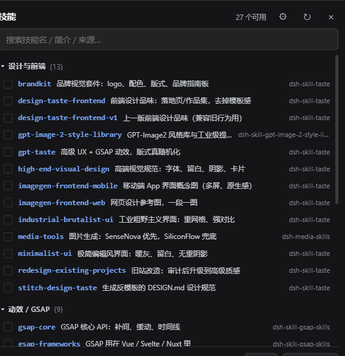

# dsh-skill-panel

> 给 **DSH（DeepSeek Harness）** 的左侧导航加一行「技能」：点开是一个悬浮气泡，按功能分类列出本机所有技能——**一条技能一行，名字 + 一句话简介 + 来源**，可搜索、可多选，点「写入输入框」就把 `/技能名` 一次性写进对话输入框。



装了 30 个技能以后，`/` 菜单是一串只有名字的列表，谁也记不住 `ppt-master` 和 `office-pptx` 到底该用哪个。这个插件把「我有哪些技能、分别是干什么的」摊开成一张可搜索、可多选的表，选完直接把指令写进输入框。

## 特性

- **一行一简介**：技能名、一句话说明（取自 `SKILL.md` 的 `description` 或首段正文）、来源包名，三列对齐，扫一眼就知道该用哪个。
- **自动按功能分类**：设计与前端 / 动效 GSAP / 办公文档 / 演示文稿 / 图像与视觉 / 联网检索 / 规范与工具 / 其他，组标题带数量，可折叠（「其他」默认收起）。分类靠技能名与简介里的中英关键词推断，**新装技能自动归组，不用改代码**。
- **搜索**：按技能名 / 简介 / 来源过滤。
- **多选 + 一键写入**：点行选中（可多选），「写入输入框」把 `/a /b /c` 写进对话输入框，接着补任务、回车发送——和 DSH 自带的 `/` 菜单是同一条路。写不进去时自动退化成复制到剪贴板。
- **窗口大小 / 字号可调**：右上角 ⚙ 里按 − / + 调窗口宽度（360–1000px）与字号（85%–160%）；也可以直接拖气泡右下角改大小，双击右下角回默认宽度。「恢复默认」= 600px / 100%。偏好存在浏览器 `localStorage`，换会话、刷新、重启都还在。字号放大时行高、内边距、圆角、按钮一起等比缩放，不会出现「字大了但挤成一团」。
- **只列「我装的」**：DSH 内置技能保持默认开启、照常在 `/` 菜单里可用，但不在这个面板里出现——列表只留你自己装的（`~/.dsh/skills` 与各插件自带的），避免「办公文档」那一组内置项把真正要选的技能淹掉。
- **新技能自动进来**：每次打开气泡重新扫盘，装完技能再打开就在里面，不用重启 DSH。
- **不占主区域**：气泡浮在界面上（`shell.overlay`），关掉就消失；Esc / 点空白处 / 右上角 × 都能关。

## 安装

> 需要 DSH 桌面端（或 Web 端）已经能正常启动，且 profile 目录可写。
> 下面的 `HUIlv0` 指仓库所有者，发布时脚本会自动替换成真实账号。

### 方式一：从 GitHub 直接装（推荐）

把本仓库作为依赖加进你的 DSH profile，然后重启一次 DSH：

```powershell
# 在 DSH profile 目录里（Windows: %USERPROFILE%\.dsh\profiles\desktop）
pnpm add github:HUIlv0/dsh-skill-panel
```

再编辑同目录的 `package.json`，把它加进 `dsh.profile.bundles`：

```json
"dsh": { "profile": { "bundles": [ "…", "dsh-skill-panel" ] } }
```

**并在 `cordis.patch.yml` 末尾加一行插入项**（不同版本 DSH 对 git 依赖的 patch 层处理略有差异，显式插入最稳）：

```yaml
- insert:
    - id: skill-panel
      name: dsh-skill-panel
```

### 方式二：本地 clone 后用脚本装

```powershell
git clone https://github.com/HUIlv0/dsh-skill-panel.git
cd dsh-skill-panel
powershell -NoProfile -ExecutionPolicy Bypass -File install.ps1          # 写入 profile 依赖 + patch + link，然后重启 DSH
```

### 方式三：只在本机试玩

把仓库目录 `pnpm link` 进 profile（`install.ps1` 做的就是这事），或直接 `pnpm add link:<仓库绝对路径>`。

## 使用

1. 左侧导航「插件」下面多一行 **技能**；
2. 点它 —— 不切页面，贴着这一行右侧弹出气泡；
3. 点行选中（可多选）→ 底栏「写入输入框」→ 输入框里出现 `/技能名`；
4. 接着补你的任务描述，回车。

| 操作 | 说明 |
| --- | --- |
| 点一行 | 选中 / 取消选中 |
| 搜索框 | 按名字、简介、来源过滤 |
| 点分组标题 | 折叠 / 展开该组 |
| 右上角 ⟳ | 重新扫盘读取技能列表 |
| 右上角 ⚙ | 窗口宽度、字号、恢复默认 |
| 拖右下角 | 自由改宽高；双击回默认宽度 |
| Esc / × / 点空白 | 关闭 |

## 卸载

```powershell
powershell -NoProfile -ExecutionPolicy Bypass -File uninstall.ps1
```

脚本会从 `cordis.patch.yml` 删掉插入项、从 `package.json` 的依赖与 `dsh.profile.bundles` 里删掉 `dsh-skill-panel`、再删掉 `node_modules` 里的链接。做完重启一次 DSH。

## 工作原理

一半在宿主（Node），一半在浏览器：

| 文件 | 作用 |
| --- | --- |
| `lib/index.js` | 宿主半区。注册 `GET /dsh-skill-panel/list.json`：扫描 `~/.dsh/skills/*/SKILL.md`、`~/.dsh/plugins/*/skills/*/SKILL.md`；`skills` 服务里的内置技能只参与去重与来源判定，**不进入列表**，输出分组 + 一句话简介。 |
| `lib/client.js` | 浏览器半区。三处注册：`sidebar.panellist` 出「技能」行；`main` 放空组件 `SkillsLauncher`（占位）；`shell.overlay` 挂气泡本体。分类、搜索、多选、尺寸偏好都在这里。 |
| `cordis.patch.yml` | 让 profile 在启动时把本插件插进配置树（`id: skill-panel`）。 |

**为什么 `main` 槽还要留一个空组件**：侧栏那一行的点击是宿主写死的（`selectPanel(id)`），对未注册的 main 面板会抛 `main panel "…" is not registered`。所以注册一个 `SkillsLauncher`，它一挂载就 `selectPanel(null)` 切回会话并弹出气泡——用户看到的是「原地弹气泡」，而不是「进了一个页面」。

简介从哪来：`SKILL.md` frontmatter 的 `description` 优先，其次第一段正文；取第一句、截断到 ~40 字。

## 自定义

- **分类规则**：改 `lib/client.js` 里的 `CATEGORY_DEFS`（先匹配技能名关键词，再匹配简介里的中英关键词，都不中进「其他」）。
- **默认尺寸/字号范围**：改 `lib/client.js` 里的 `PREF_DEFAULTS` 与 `clampPrefs()`；样式表里尺寸一律写 `px`，`cssText()` 会按字号比例逐个乘系数——**新加样式也必须用 px**，写 em/rem 不会跟着字号缩放。

## 已知限制

- 只列「文件系统里的技能」（`~/.dsh/skills`、各插件包的 `skills/`）；DSH 内置技能保持默认开启，但不在面板里显示；纯远程/市场未安装的技能不会出现。
- 写入输入框依赖 DSH 的 Lexical 编辑器，只认 `document.execCommand('insertText')`；若未来编辑器换成别的实现，会退化为「复制到剪贴板」。
- 连续调用插入会插进多份，所以一次只写一次。

## 发布 / 更新到 GitHub

本机没有 git 也能发：`publish.mjs` 直接走 GitHub REST API。

```powershell
# 首次：建仓库 + 上传全部文件 + 打 v1.0.0 release（带上 zip 附件）
$env:GITHUB_TOKEN="ghp_xxx"        # 需要 repo 权限（经典 PAT）或 Contents+Administration 权限（细粒度）
node publish.mjs --owner 你的账号 --repo dsh-skill-panel --zip ..\dsh-skill-panel-v1.0.0.zip

node publish.mjs --owner 你的账号 --dry-run    # 只看要发什么，不真发
```

脚本会：

1. `GET /user` 校验 token；
2. 仓库不存在就 `POST /user/repos` 建一个（默认 public）；
3. 逐个文件 `PUT /contents/{path}`（已存在的先取 sha 再覆盖，所以重复跑就是更新）；
4. 有 `--zip` 就建 `v1.0.0` tag + release，并把 zip 传成附件。

不想给 token？也可以网页手工上传：在 GitHub 上新建仓库，把所有文件（除 `node_modules`、`.tmp*`、`*.zip`）拖进去，然后在 Releases 里手建一版。

## License

MIT © dsh-skill-panel contributors
